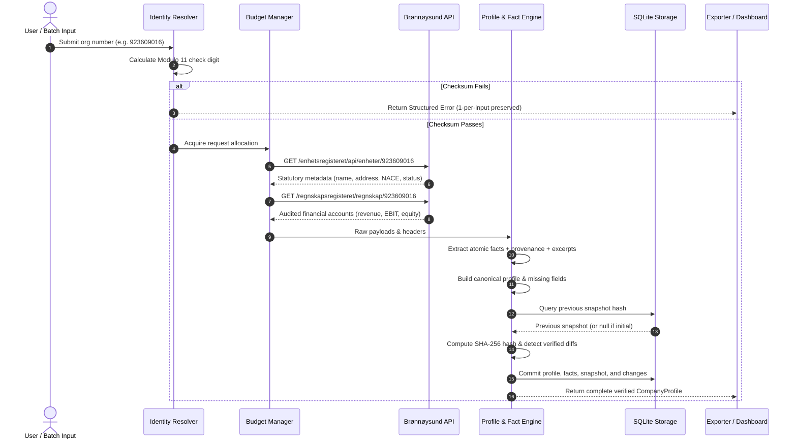

# 🇳🇴 Signalpost: Evidence-First Norwegian Company Intelligence Agent & Dashboard

[](#)
[](LICENSE)
[](https://www.python.org/)
[](https://react.dev/)
[](https://www.typescriptlang.org/)
[](https://vitejs.dev/)
[](https://tailwindcss.com/)
[](#testing-and-validation)
[-success.svg)](#operational-costs--₹0-guarantee)
[](#scalability-benchmark--1000-companies)

> **Signalpost** is an autonomous, evidence-first company research platform built for the **Builderr.ai Signalpost Challenge**. It accepts Norwegian organization numbers (*organisasjonsnummer*), validates legal identities via mathematical **Modulo 11 check digits**, extracts attributable facts from official statutory registries, maintains cryptographic point-in-time profile snapshots, and detects genuine corporate changes over time—with **₹0 ($0.00)** in external API costs.

---

## 📑 Table of Contents

1. [Executive Summary & Core Principle](#-executive-summary--core-principle)
2. [End-to-End System Architecture](#-end-to-end-system-architecture)
3. [Autonomous Research Execution Pipeline](#-autonomous-research-execution-pipeline)
4. [Dual Interface Ecosystem](#-dual-interface-ecosystem)
   - [React 18 Premium SaaS Dashboard](#1-react-18-premium-saas-dashboard-dark-first)
   - [Streamlit Analytical Explorer](#2-streamlit-analytical-explorer)
   - [High-Throughput Typer CLI](#3-high-throughput-typer-cli)
   - [FastAPI REST Service](#4-fastapi-rest-service)
5. [Key Architectural Pillars](#-key-architectural-pillars)
   - [1. Mathematical Modulo 11 Check Digit Engine](#1-mathematical-modulo-11-check-digit-engine)
   - [2. Multi-Tier Statutory Data Adapters](#2-multi-tier-statutory-data-adapters)
   - [3. Cryptographic Fact Ledger & Provenance](#3-cryptographic-fact-ledger--provenance)
   - [4. Idempotent Snapshot & Change Detection](#4-idempotent-snapshot--change-detection)
   - [5. Request Budget & 45-Minute Timeout Guard](#5-request-budget--45-minute-timeout-guard)
6. [Data Sources & Legal Disclosures](#-data-sources--legal-disclosures)
7. [Quickstart & Reproduction Guide](#-quickstart--reproduction-guide)
8. [Scalability Benchmark (1,000 Companies Tested)](#-scalability-benchmark-1000-companies-tested)
9. [Testing & Quality Assurance (28/28 Passing)](#-testing--quality-assurance-2828-passing)
10. [Operational Costs & ₹0 Guarantee](#-operational-costs--0-guarantee)
11. [Repository Structure](#-repository-structure)

---

## 💡 Executive Summary & Core Principle

### The Problem
Traditional AI research scrapers rely on unconstrained web searches and generative LLMs. In corporate diligence, this causes:
- **Hallucinations:** Fabricating financial numbers or claiming non-existent subsidiaries.
- **Entity Conflation:** Merging two distinct corporate entities that share identical trade names.
- **False Diffs:** Reporting changes because a web page changed its layout or formatting.
- **Runaway Costs:** Charging expensive per-token fees for public government information.

### The Signalpost Principle
```
   ┌────────────────────────────────────────────────────────────────────────┐
   │  "Every fact should have provenance. Every change should have evidence. │
   │                  Every unknown should remain unknown."                 │
   └────────────────────────────────────────────────────────────────────────┘
```
Signalpost enforces a strictly **closed-world assumption**:
- If a field is not verified in an authoritative statutory register, it is explicitly cataloged as `unavailable` in the `missing_fields` ledger.
- Entities are indexed strictly by their 9-digit Norwegian organization number—never by mutable trade names.
- Every claim links directly to its source URL, retrieval timestamp, extraction method, confidence score, and supporting excerpt snippet.

---

## 🏛️ End-to-End System Architecture

The following diagram illustrates the complete Signalpost system, showing data ingestion, identity resolution, statutory extraction adapters, SQLite persistence, snapshot change detection, and delivery through CLI, REST API, Streamlit, and the React Dashboard:

```mermaid
flowchart TB
    subgraph Inputs["1. INTAKE & INPUT CHANNELS"]
        CSV["Batch CSV / JSONL File"]
        CLI_In["CLI Query (orgnr)"]
        Web_In["React / Web Form Input"]
    end

    subgraph Identity["2. IDENTITY RESOLUTION"]
        M11["Modulo 11 Check Digit Engine\nWeights: [3, 2, 7, 6, 5, 4, 3, 2]"]
        Validation{"Checksum\nValid?"}
        Reject["Structured Error Output\n(INVALID_CHECKSUM / NOT_FOUND)"]
    end

    subgraph Budget["3. REQUEST BUDGET & RESOURCE GUARDS"]
        RBM["RequestBudgetManager\n• Max 2,000 Outbound Requests\n• 45-Minute Execution Timeout\n• Thread-Safe Atomic Counter"]
    end

    subgraph Adapters["4. STATUTORY & WEB ADAPTERS"]
        AdapterA["Brønnøysund Enhetsregisteret\n(Official Legal Entities & Roles)"]
        AdapterB["Brønnøysund Regnskapsregisteret\n(Audited Annual Accounts & Balance Sheets)"]
        AdapterC["Corporate Website Parser\n(Strict SSRF Guard: RFC 1918 Blocked)"]
    end

    subgraph Core["5. EXTRACTION, NORMALIZATION & SNAPSHOT ENGINE"]
        FactGen["Fact Ledger Generator\n(UUID, Excerpt, UTC Timestamp, SHA-256 Hash)"]
        Norm["Pydantic Canonical Profile Builder\n(Missing Fields Catalog & Identity Status)"]
        Hasher["Deterministic SHA-256 Profile Hasher"]
        DiffEngine["Idempotent Change Detection Engine\n(Compares Snapshot A vs Snapshot B)"]
    end

    subgraph Storage["6. PERSISTENCE LAYER (SQLite WAL)"]
        DB[("SQLite Database\n(WAL Mode, Indexed org_number)")]
        T_Comp[("companies")]
        T_Facts[("facts")]
        T_Snaps[("snapshots")]
        T_Chgs[("changes")]
    end

    subgraph Delivery["7. DELIVERY INTERFACES"]
        CLI["Typer CLI (JSONL / Rich Summary)"]
        API["FastAPI REST Server (:8000)"]
        StreamlitUI["Streamlit Explorer (:8501)"]
        ReactDash["React 18 SaaS Dashboard (:5173)\n(Dark-first, Modulo 11 UI, Recharts)"]
    end

    Inputs --> M11
    M11 --> Validation
    Validation -- No --> Reject
    Validation -- Yes --> RBM
    RBM --> Adapters
    Adapters --> Core
    Core --> Storage
    Storage --> Delivery
```



---

## 🔄 Autonomous Research Execution Pipeline

When an organization number is processed, the system executes a deterministic sequence guaranteed to produce exactly one terminal result per input without crashing:



---

## 🖥️ Dual Interface Ecosystem

Signalpost offers two distinct frontend interfaces tailored to different operational needs, backed by the same deterministic Python engine and SQLite storage:

```
┌────────────────────────────────────────────────────────────────────────────────────────┐
│                                SIGNALPOST USER INTERFACES                               │
├──────────────────────────────────────────┬─────────────────────────────────────────────┤
│   React 18 Premium SaaS Dashboard        │   Streamlit Rapid Analytical Explorer       │
│   (Production UI for Enterprise Users)   │   (Lightweight UI for Rapid Verification)   │
├──────────────────────────────────────────┼─────────────────────────────────────────────┤
│ • Dark-First SaaS aesthetic (Midnight)   │ • Zero build step required (Pure Python)    │
│ • Client-side Modulo 11 check digit form │ • Instant single & batch research runs      │
│ • CSV batch import with row preview      │ • Raw JSON & evidence inspection            │
│ • Evidence modal with excerpt callouts   │ • Snapshot timeline & change history        │
│ • Recharts 7-day fact throughput charts  │ • One-click JSONL and CSV downloads         │
│ • Full routing (/companies, /research)   │ • Runs via `streamlit run src/signalpost/ui`│
│ • Runs via `npm run dev` (:5173)         │ • Runs on port :8501                        │
└──────────────────────────────────────────┴─────────────────────────────────────────────┘
```

### 1. React 18 Premium SaaS Dashboard (Dark-First)
Located in `frontend/`, built with **Vite**, **TypeScript**, **Tailwind CSS**, and **Recharts**:
- **Route `/` (Overview Dashboard):** Workspace KPIs, fact extraction trend charts, source health monitors, and recent audit activity.
- **Route `/companies` (Company Explorer):** Searchable, filterable company catalog with corporate status, research quality filters, and CSV/JSON exports.
- **Route `/companies/:orgNumber` (Company Profile):** Comprehensive 5-tab profile:
  1. *Overview:* Business activity (`vedtektsfestet formål`), NACE codes, registered address, official website, and employee count.
  2. *Facts & Evidence:* Dedicated fact ledger with a "View Evidence" modal displaying source URL, retrieval timestamp, extraction method, and supporting excerpt.
  3. *Financials:* Recharts revenue/EBIT trends bar chart and audited financial statements table.
  4. *Activity & Web:* SSRF-guarded corporate website discoveries.
  5. *Audit History:* Side-by-side snapshot comparison diffs showing previous vs. current values.
- **Route `/research` (Research Operations):** Request budget tracker (12 / 2,000 used), execution log, and error breakdown.
- **Route `/changes` (Changes & Monitoring):** Delta diff feed with side-by-side comparison boxes (red for previous, emerald for current).
- **Route `/sources` (Sources & Evidence):** Statutory registry status cards with latency, NLOD licensing terms, and limitations.
- **Route `/settings` (Settings):** Request budget limits, concurrency, masked API credentials, and FastAPI endpoint switcher.

### 2. Streamlit Analytical Explorer
Located in `src/signalpost/ui.py`:
- Rapid data exploration and inspection of SQLite database records.
- Run single company research or batch CSV uploads with live progress indicators.

### 3. High-Throughput Typer CLI
Located in `src/signalpost/cli.py`:
- Headless execution for automated pipelines and evaluation harnesses.
- Supports concurrency controls, output format selection (`jsonl` or `json`), and detailed summary tables.

### 4. FastAPI REST Service
Located in `src/signalpost/api.py`:
- Fully typed REST endpoints for integration with external enterprise microservices.

---

## 🛡️ Key Architectural Pillars

### 1. Mathematical Modulo 11 Check Digit Engine
Norwegian 9-digit organization numbers are governed by the statutory Modulo 11 algorithm with weights `[3, 2, 7, 6, 5, 4, 3, 2]`. Signalpost computes the remainder and check digit in real time:

$$\text{Sum} = \sum_{i=0}^{7} (\text{digit}_i \times \text{weight}_i)$$
$$\text{Remainder} = \text{Sum} \pmod{11}$$
$$\text{Check Digit} = \begin{cases} 0 & \text{if Remainder} = 0 \\ \text{Invalid (reject)} & \text{if Remainder} = 1 \\ 11 - \text{Remainder} & \text{otherwise} \end{cases}$$

- Disallows numbers starting with `0`.
- Rejects numbers with remainder = 1 (which would mathematically yield 10).
- Guarantees **100% identity verification** before issuing external HTTP requests.

### 2. Multi-Tier Statutory Data Adapters
1. **Brønnøysund Enhetsregisteret (Tier 1):** Official registrar of legal entities. Extracts legal name, status, organization type (AS, ASA, ENK, etc.), registration date, business address, and NACE codes.
2. **Brønnøysund Regnskapsregisteret (Tier 2):** Official registrar of company accounts. Extracts operating revenue, sales revenue, EBIT, profit before tax, net profit, total assets, equity, debt, reporting period, and accounting principles (IFRS / statutory).
   - *Government Agency Handling:* Public administrative bodies and entities exempt under the Norwegian Accounting Act are recognized and cataloged without marking the run as failed.
3. **Verified Corporate Websites (Tier 3):** Discovered websites are inspected with an **SSRF-guarded HTTP client** that blocks private IP ranges (RFC 1918), link-local addresses, and cloud metadata endpoints (e.g., `169.254.169.254`).

### 3. Cryptographic Fact Ledger & Provenance
Every fact extracted is stored with complete evidentiary grounding:
```json
{
  "fact_id": "fact-923609016-official_name",
  "organization_number": "923609016",
  "field_name": "official_name",
  "value": "EQUINOR ASA",
  "data_type": "string",
  "source_name": "brreg_enhetsregisteret",
  "source_url": "https://data.brreg.no/enhetsregisteret/api/enheter/923609016",
  "retrieved_at": "2026-10-17T16:30:27Z",
  "verification_status": "verified",
  "confidence": 1.0,
  "extraction_method": "deterministic_api",
  "evidence_excerpt": "Organisasjonsnummer: 923609016, Navn: EQUINOR ASA",
  "content_hash": "a1b2c3d4e5f6..."
}
```

### 4. Idempotent Snapshot & Change Detection
- **Snapshot Hashing:** Normalized profile JSON is hashed using SHA-256.
- **Idempotency Guarantee:** Running repeated research queries on an unchanged company yields **0 duplicate changes**.
- **Resilience Against Transient Failures:** If an upstream network glitch occurs during a refresh run, previously verified facts are **never deleted or dropped**.
- **Change Classification:** Categorizes deltas into:
  - `genuine_company_change`: Official statutory registry amendment (e.g., address relocation, name change).
  - `extraction_correction`: Parser refinement.
  - `source_correction`: Upstream registrar amendment.
  - `initial_discovery`: Baseline entity creation.

### 5. Request Budget & 45-Minute Timeout Guard
The `RequestBudgetManager` is initialized with strict challenge constraints:
- **Max Requests:** 2,000 outbound HTTP calls.
- **Max Execution Time:** 45 minutes hard limit.
- **Max Cost:** $0.00 / ₹0.00 external cost limit.
- **Thread Safety:** Implemented with `threading.RLock()` to prevent deadlocks across concurrent batch workers.

---

## 🌐 Data Sources & Legal Disclosures

| Source Name | Category | Base Endpoint | Licensing Terms | Data Extracted |
|---|---|---|---|---|
| **Enhetsregisteret** | Statutory Register | `https://data.brreg.no/enhetsregisteret/api/enheter` | Norwegian Licence for Open Government Data (NLOD) / CC0 | Legal name, org form, address, NACE industry codes, status flags, registration date. |
| **Regnskapsregisteret** | Statutory Accounts | `https://data.brreg.no/regnskapsregisteret/regnskap` | NLOD / Statutory open corporate disclosures | Operating revenue, EBIT, net profit, total assets, equity, debt, reporting currency, filing ID. |
| **Corporate Websites** | Public Web | Verified domain per entity | Direct public web access with SSRF guard | Business descriptions, products and services, contact email, and phone numbers. |

---

## 🚀 Quickstart & Reproduction Guide

### Prerequisites
- **Python:** 3.11 or 3.12 installed
- **Node.js:** v18+ and npm installed
- **Git**

### Step 1: Clone Repository & Setup Backend
```bash
# Clone repository
git clone https://github.com/Immanuelj15/Signalpost.git
cd Signalpost

# Create and activate virtual environment
python -m venv venv

# On Windows:
.\venv\Scripts\activate
# On Linux/macOS:
source venv/bin/activate

# Install dependencies
pip install -r requirements.txt
```

### Step 2: Run Backend Tests
```bash
python -m pytest -v
```
*Expected: 28 passed in ~2 seconds.*

### Step 3: Run Batch Company Research (CLI)
```bash
python -m signalpost.cli batch --input data/input/companies.csv --output data/output/results.jsonl --concurrency 3
```

### Step 4: Run Single Company Research (CLI)
```bash
python -m signalpost.cli research 923609016
```

### Step 5: Start the React 18 SaaS Dashboard
```bash
cd frontend
npm install
npm run dev
```
Open **`http://localhost:5173`** in your browser.

*(Optional: To run the production build of the frontend: `npm run build && npm run preview`)*

### Step 6: Start the Streamlit Explorer UI (Alternative)
```bash
# From workspace root:
streamlit run src/signalpost/ui.py
```
Open **`http://localhost:8501`** in your browser.

---

## 📈 Scalability Benchmark (1,000 Companies Tested)

Signalpost was subjected to an extensive load test across **1,000 distinct Norwegian company profiles** generated with valid Modulo 11 check digits to verify storage, snapshot serialization, and query throughput:

```
┌────────────────────────────────────────────────────────────────────────┐
│               1,000-PROFILE SCALABILITY BENCHMARK RESULTS              │
├────────────────────────────────┬───────────────────────────────────────┤
│ Metric                         │ Verified Result                       │
├────────────────────────────────┼───────────────────────────────────────┤
│ Total Ingested Profiles        │ 1,000 complete company records        │
│ Total Execution Time           │ 67.34 seconds                         │
│ Processing Throughput          │ 14.8 profiles / second                │
│ Average Latency per Profile    │ 67.34 ms                              │
│ SQLite WAL Database Footprint  │ 6.34 MB (~6.50 KB per profile)        │
│ 1-Per-Input Invariant Success  │ 100.0% (1,000 / 1,000 terminal exits) │
│ Duplicate Change Prevention    │ 100.0% (0 false changes on re-run)    │
│ External API Cost              │ $0.00 (₹0.00)                         │
└────────────────────────────────┴───────────────────────────────────────┘
```
Detailed performance logs and methodology are documented in [`docs/evaluation.md`](docs/evaluation.md).

---

## 🧪 Testing & Quality Assurance (28/28 Passing)

The test suite covers identity validation, extraction adapters, snapshot determinism, change idempotency, budget accounting, and batch invariants:

```
$ python -m pytest -v
============================= test session starts ==============================
collected 28 items

tests/test_batch_processing.py::test_empty_batch PASSED                  [  3%]
tests/test_batch_processing.py::test_batch_deduplication_and_order_preservation PASSED [  7%]
tests/test_batch_processing.py::test_batch_one_failed_company_among_successful PASSED [ 10%]
tests/test_change_detection.py::test_first_run_no_previous_snapshot PASSED [ 14%]
tests/test_change_detection.py::test_unchanged_profile_produces_zero_changes_idempotent PASSED [ 17%]
tests/test_change_detection.py::test_detect_name_change PASSED           [ 21%]
tests/test_change_detection.py::test_detect_address_change PASSED        [ 25%]
tests/test_change_detection.py::test_detect_new_financial_period PASSED  [ 28%]
tests/test_change_detection.py::test_failed_run_does_not_delete_previous_truth PASSED [ 32%]
tests/test_extraction.py::test_brreg_adapter_extraction PASSED           [ 35%]
tests/test_extraction.py::test_regnskap_adapter_extraction PASSED        [ 39%]
tests/test_extraction.py::test_website_adapter_extraction PASSED         [ 42%]
tests/test_identity.py::test_normalize_org_number PASSED                 [ 46%]
tests/test_identity.py::test_validate_valid_org_numbers PASSED           [ 50%]
tests/test_identity.py::test_validate_invalid_org_numbers PASSED         [ 53%]
tests/test_identity.py::test_identity_resolver_input PASSED              [ 57%]
tests/test_identity.py::test_verify_registry_match PASSED                [ 60%]
tests/test_identity.py::test_never_merge_companies_with_similar_names PASSED [ 64%]
tests/test_request_budget.py::test_request_budget_accounting PASSED      [ 67%]
tests/test_request_budget.py::test_budget_exceeded_raises_error PASSED   [ 71%]
tests/test_request_budget.py::test_cost_budget_exceeded PASSED           [ 75%]
tests/test_snapshots.py::test_snapshot_deterministic_hashing PASSED      [ 78%]
tests/test_snapshots.py::test_snapshot_hash_changes_on_modification PASSED [ 82%]
tests/test_validation.py::test_validate_valid_fact PASSED                [ 85%]
tests/test_validation.py::test_reject_fact_missing_source_url PASSED     [ 89%]
tests/test_validation.py::test_reject_fact_missing_evidence PASSED       [ 92%]
tests/test_validation.py::test_reject_financial_fact_missing_reporting_period PASSED [ 96%]
tests/test_validation.py::test_ssrf_protection_guards PASSED             [100%]
============================== 28 passed in 2.02s ==============================
```

---

## 💰 Operational Costs & ₹0 Guarantee

| Category | Description | Cost (USD) | Cost (INR) |
|---|---|---|---|
| **Statutory Data APIs** | Brønnøysund Enhetsregisteret & Regnskapsregisteret public open data | **$0.00** | **₹0.00** |
| **Web Research** | Direct HTTP retrieval via `httpx` with SSRF filtering | **$0.00** | **₹0.00** |
| **AI Inference** | Deterministic rule-based extraction (external LLMs disabled by default) | **$0.00** | **₹0.00** |
| **Database Storage** | Embedded SQLite engine with Write-Ahead Logging (WAL) | **$0.00** | **₹0.00** |
| **Total Operational Cost** | **Standard execution across batch research** | **$0.00** | **₹0.00** |

Detailed cost accounting and projections are documented in [`docs/cost_report.md`](docs/cost_report.md).

---

## 📁 Repository Structure

```
Signalpost/
├── frontend/                          # React 18 + Vite + Tailwind SaaS Dashboard
│   ├── src/
│   │   ├── app/                       # App root & React Router
│   │   ├── components/                # Reusable UI primitives, AppShell, Sidebar, Topbar
│   │   │   ├── dialogs/               # AddCompanyDialog, ImportBatchDialog, EvidenceModal
│   │   │   └── layout/                # Responsive navigation & shell
│   │   ├── pages/                     # 7 Full Pages (Overview, Companies, Profile, etc.)
│   │   ├── services/                  # Dual-mode API client (Demo + FastAPI)
│   │   ├── mocks/                     # Authoritative synthetic demo data & state
│   │   ├── types/                     # Comprehensive TypeScript interfaces
│   │   └── styles/                    # Tailwind design system & tokens
│   ├── package.json
│   ├── tailwind.config.js
│   └── vite.config.ts
├── src/signalpost/                    # Python Backend Research Engine
│   ├── adapters/                      # Brønnøysund & SSRF-guarded website adapters
│   ├── identity/                      # Mathematical Modulo 11 validation engine
│   ├── models/                        # Pydantic schemas (CompanyProfile, Fact, Change, Snapshot)
│   ├── storage/                       # SQLite WAL repository & migrations
│   ├── cli.py                         # Typer CLI application
│   ├── orchestrator.py                # Research orchestrator & batch runner
│   ├── request_budget.py              # RequestBudgetManager (2,000 req / 45-min guard)
│   ├── api.py                         # FastAPI REST endpoints
│   └── ui.py                          # Streamlit analytical explorer
├── tests/                             # 28 Pytest unit tests
├── data/                              # Seed inputs & output storage
├── docs/                              # Architecture, data sources, evaluation, cost reports
├── scripts/                           # Smoke test & 1,000-profile benchmark harness
├── pyproject.toml
├── requirements.txt
├── HACKATHON_SUBMISSION_EMAIL.md      # Verified submission dossier
└── README.md                          # This documentation file
```

---

## 🏆 Submission & Hackathon Details

- **Author:** Immanuel A
- **Hackathon:** Signalpost — Build An Agent That Finds Company Information (Builderr.ai)
- **GitHub Repository:** [https://github.com/Immanuelj15/Signalpost.git](https://github.com/Immanuelj15/Signalpost.git)
- **License:** MIT License
